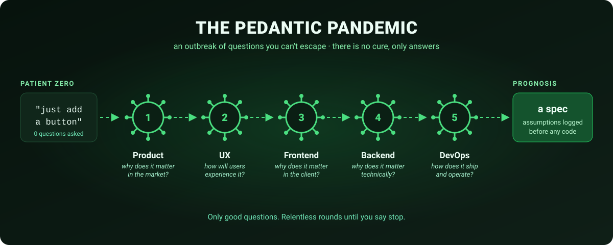

<div align="center">

# The Pedantic Pandemic 🦠

[](LICENSE)

### Five pedantic teammates who grill your request before a line of code exists.

**Patient zero: your half-baked request. Symptoms: 40 questions and rising. Prognosis: a spec.**


**[Install](#install) · [The roster](#the-roster) · [How it works](#how-it-works) · [Example](#example) · [FAQ](#faq) · [Repo layout](#repo-layout)**



</div>

---

A set of Claude Code skills (and matching Cursor rules) that interrogate a request, relentlessly, **before** any work starts, so every hidden assumption surfaces while it is still cheap to change. Each persona owns one discipline, asks only questions that would change a decision, and keeps going until you say *stop*. Then it writes down the assumptions it was forced to make.

## Why I made this

Every team has that one person you cannot actually fault. They ask the questions nobody else thought of, the ones that save you a week of rework three months later. And they are also, let's be honest, *a little exhausting*: the thing you figured was "just add a button" turns into forty questions about empty states, rollback plans, and who actually asked for this.

You cannot fault them. The questions are good. They are just relentless.

**This is that person, bottled.** Five of them, actually, one per discipline. The Pedantic Pandemic takes the most useful annoying-coworker instinct, relentless high-signal questioning, and points it at your half-baked request *before* you write a line of code. Every question has to clear a strict "is this actually worth asking?" bar. And unlike the real coworker, you can tell it to stop the moment you have had enough.

## Install

### Claude Code

```bash
git clone https://github.com/AlienWalker1995/pedantic-pandemic.git
mkdir -p ~/.claude/skills
cp -r pedantic-pandemic/.claude/skills/pedantic-* ~/.claude/skills/        # every project
# or: cp -r pedantic-pandemic/.claude/skills/pedantic-* <your-repo>/.claude/skills/   # one project
```

Claude Code discovers each `SKILL.md` from its frontmatter, which gives you six commands. Run `/pedantic-team` for the full ordered grilling, or a single member for one lens. Each `SKILL.md` is self-contained.

### Cursor

The same six personas ship as Cursor rules in `.cursor/rules/pedantic-*.mdc`. Copy them into your project's `.cursor/rules/`. Each is an *Agent Requested* rule (`alwaysApply: false`): Cursor pulls the matching persona in when your task fits, or you name one in chat ("use the pedantic-pm rule"). Cursor has no `AskUserQuestion` selector, so the personas fall back to the numbered quick-pick questions they already describe; behavior is otherwise identical.

## The roster

The team interrogates in flow order, and each phase informs the next.

| # | Skill | Role | Organizing question | Owns |
|---|---|---|---|---|
| 1 | `/pedantic-pm` | Product Manager | *"Why does this matter **in the market**?"* | problem/JTBD, segment, value, metrics, scope, prioritization, business model |
| 2 | `/pedantic-ux` | UX Designer | *"How will the user **actually experience** this?"* | flows, IA, states, interaction, content, accessibility, responsiveness |
| 3 | `/pedantic-frontend` | Frontend Engineer | *"Why does this matter **in the client**?"* | rendering, components, state, data fetching, performance, a11y implementation |
| 4 | `/pedantic-engineer` | Backend / Core Engineer | *"Why does this matter **technically**?"* | data model, APIs, coupling, edge cases, security, backward compatibility, testing |
| 5 | `/pedantic-devops` | DevOps / SRE Engineer | *"How does it **ship and operate** reliably?"* | CI/CD, infra/IaC, config/secrets, scaling, reliability/SLOs, observability |
| · | `/pedantic-team` | Team lead (orchestrator) | all of the above, in order | runs the five members Product → UX → Frontend → Backend → DevOps |

## How it works

Every persona runs the same protocol, defined once in [`skill/interrogation-protocol.md`](skill/interrogation-protocol.md):

| Step | What happens |
|---|---|
| **Classify** | The request is labeled clear, partially specified, dangerously ambiguous, or conflicting. |
| **Relentless rounds** | Questions arrive through the interactive `AskUserQuestion` selector: broad first, then deeper follow-ups generated from each answer. |
| **Never "enough"** | The persona never declares itself satisfied. Only you end it, with *stop*, *proceed*, or *just build it*. |
| **Forced assumptions** | On stop, it emits an "Assumptions I'm forced to make" block, so every gap you skipped is written down instead of silently guessed. |

**The one rule: only good questions.** Volume comes from breadth and depth, never padding. Every question must be decision-changing, specific, non-redundant, and assumption-exposing. A flood of mediocre questions is the failure mode, and each member has its own question bank (`skill/*-question-bank.md`) to keep it on its own turf.

## Example

From [`examples/team-combined-interrogation.md`](examples/team-combined-interrogation.md), `/pedantic-team` on "Let's add notifications." (abridged):

```
🦠 The Pedantic Pandemic — Round 1
Classification: dangerously ambiguous (no user, no goal, no channel, no technical surface)

## 🔧 Engineering — why does it matter technically?
1. Does an event source for these notifications already exist?
   a) yes, there's an activity/events stream to hook   b) no, it must be built   c) unsure
2. Delivery transport?
   a) integrate existing provider (APNs/FCM/web-push)   b) build transport   c) email only (SMTP)

## 📈 Product — why does it matter in the market?
5. Core job for the user?
   a) re-engagement   b) time-sensitive alerts   c) reduce anxiety   d) drive an action
```

More in [`examples/`](examples/): a vague feature request, an ambiguous bug report, an under-specified refactor, an architecture review, and a PM-only grilling.

## FAQ

**Will it ever stop asking?** Only when you tell it to. That is the point: you decide when the remaining ambiguity is acceptable, and it records what it had to assume.

**Do I have to run all five?** No. `/pedantic-team` runs the whole flow; any single member gives you one lens, such as `/pedantic-devops` before a deploy change.

**Is the pandemic theme in the questions?** No. The 🦠 flavor lives in headers and this README. The questions themselves stay plain, sharp, and professional.

**How do I change a persona?** Edit its `.claude/skills/<role>/SKILL.md`, then run `scripts/sync-cursor.sh` to regenerate the Cursor rules and `scripts/validate.sh` to check both runtimes still load.

## Repo layout

```
.claude/skills/<role>/SKILL.md   the six invocable /pedantic-* skills (single source of truth)
.cursor/rules/pedantic-*.mdc     the same six, generated for Cursor by scripts/sync-cursor.sh
skill/                           shared protocol, per-member question banks, behavior and refusal policy
examples/                        worked interrogations, one per scenario
evals/                           rubric, test cases, and golden outputs for judging persona quality
docs/                            overview, design principles, decision log, usage patterns
scripts/validate.sh              skill-loadability and structure checks for both runtimes
scripts/sync-cursor.sh           regenerates the Cursor rules from the SKILL.md files
CLAUDE.md                        editing conventions for working on this repo
```

## License

[MIT](LICENSE) © 2026 AlienWalker1995
